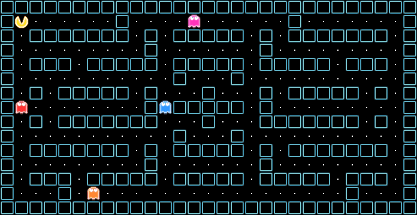
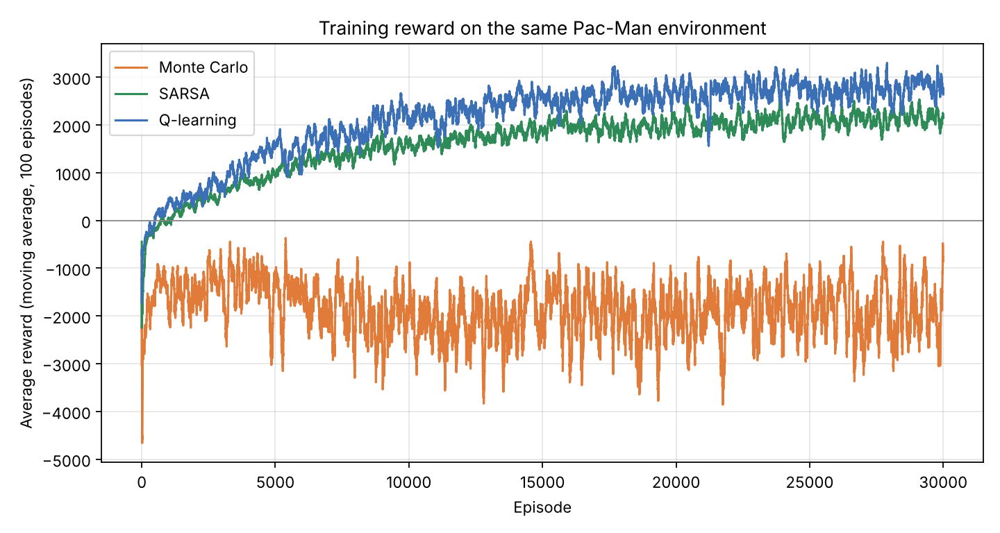

# Pac-Man 強化式學習：Monte Carlo、SARSA 與 Q-learning 比較

Reinforcement learning in a custom Pac-Man environment: tabular Monte Carlo control, SARSA and Q-learning compared on the same map, rewards and settings.

這是國立中興大學電機工程學系碩士班「強化式學習」課程的 4 人小組期末專案。我們用 Python 建立一個 Pac-Man 環境，讓三種表格型強化式學習演算法在同樣的條件下學習吃豆、避開鬼，再比較它們的學習速度與表現。

## 專案來源

| 部分 | 來源 |
| --- | --- |
| 環境 `pacman_rl_env.py`、Monte Carlo、SARSA 的訓練／評估／展示程式 | 小組課堂專案的原始程式 |
| Q-learning（`qlearning_agent.py`、`train_qlearning.py` 等） | 原始程式未保存；黃煜翔於課後依相同環境與參數重新實作並訓練 |
| `evaluate_all.py`、`tools/make_figures.py` | 課後新增：統一評估條件、產生圖表與動畫 |
| `main_original.py`、`unit.py`、`material/` | 改寫前的基礎 Pac-Man 遊戲與素材（來源：【待補：原作者與網址】） |
| `docs/course_report.pdf` | 小組課堂期末報告 |

## 示範

三種演算法在同一局（固定隨機種子 0）的表現：

| Monte Carlo | SARSA | Q-learning |
| --- | --- | --- |
|  |  |  |
| 43 步後被抓，分數 180 | 412 步，分數 1,940，剩 21 顆豆子時被抓 | 379 步，分數 1,880，剩 27 顆豆子時被抓 |

黃色是 Pac-Man，四隻鬼隨機移動。這只是一局的示範，整體表現請看下面 100 局的結果。

## 結果

### 統一條件重新評估（100 局）

三種演算法都以訓練好的策略、關閉探索（ε = 0）各玩 100 局。第 i 局的環境和平手時的動作選擇都固定用隨機種子 i，所以三者面對的是完全相同的 100 局，結果每次執行都一樣（`python evaluate_all.py`）。

| 指標 | Monte Carlo | SARSA | Q-learning |
| --- | ---: | ---: | ---: |
| 平均分數 | 907.6 | 1701.6 | 1716.3 |
| 最高分 | 1630 | 2150 | 2150 |
| 平均步數 | 316.3 | 405.5 | 364.1 |
| 勝率（吃完所有豆子） | 0% | 14% | 18% |
| 死亡率 | 93% | 82% | 78% |
| 逾時率（走滿 1,000 步） | 7% | 4% | 4% |
| 平均獎勵 | −2366.7 | 122.3 | 1299.2 |

結局依環境實際結束一局的三種條件分類：吃完所有豆子（勝利）、被鬼抓到（死亡）、走滿 1,000 步（逾時）。

SARSA 與 Q-learning 的平均分數接近（1,701.6 與 1,716.3），Q-learning 的勝率略高（18% 與 14%）。Monte Carlo 的 100 局中沒有任何一局吃完所有豆子，93% 被鬼抓到。三種方法的死亡率都在 78% 以上，被鬼抓到仍是最主要的結局。

### 學習曲線



三種演算法各訓練 30,000 局，曲線為每 100 局的平均獎勵。SARSA 與 Q-learning 分別在第 714 局與第 488 局之後，平均獎勵轉為正值並持續上升，最後 1,000 局的平均約為 2,162 與 2,834。Monte Carlo 一直停在負值，看不出明顯進步：一局常有數百步，要等整局結束才更新，回饋太慢。

### 和課堂報告數字的差異

課堂報告（`docs/course_report.pdf`）中的測試結果如下，Q-learning 欄是當時已遺失的原始程式所跑出的數字：

| 指標 | Monte Carlo | SARSA | Q-learning（原始程式） |
| --- | ---: | ---: | ---: |
| 平均分數 | 911.3 | 1681.9 | 1720.1 |
| 最高分 | 1640 | 2150 | 2150 |
| 平均步數 | 320.11 | 310.14 | 374.17 |
| 死亡率 | 84% | 85% | 78% |
| 逾時率 | 11% | 3% | 0% |
| 勝率 | 5% | 12% | 22% |
| 平均獎勵 | −2369.23 | 2739.76 | 1087.59 |

和上面重新評估的數字不同，原因有三個：

1. **評估有隨機性。** 原本的 `evaluate_mc.py`、`evaluate_sarsa.py` 雖然固定了環境的種子，但 agent 遇到 Q 值相同的動作時隨機選擇，這個隨機沒有固定種子，所以每次執行的數字都會有些微差異（例如 SARSA 的死亡率在 72%–79% 之間變動）。
2. **結局的分類方式。** 環境中「連續 150 步沒吃到豆子」只會扣獎勵，不會結束這一局；原本的評估程式卻把「死前已 150 步以上沒吃豆」的局算成逾時，而走滿 1,000 步的局沒有計入任何類別，報告再用「100% − 死亡率 − 逾時率」算勝率，因此走滿 1,000 步的局被算成了勝利。以 Monte Carlo 為例，重新檢查這 100 局，沒有任何一局吃完所有豆子。
3. **Q-learning 是重新實作與重新訓練的。** 重新訓練時最差的一局獎勵為 −38,455，和報告記錄的原始 Q-learning 最差單局完全相同；用原本寫法的 `evaluate_qlearning.py` 評估，平均分數為 1,721.2，也接近報告的 1,720.1。因此重新實作的行為很可能和原始程式一致，但沒有原始程式可以比對，無法完全確認。

## 環境設計

- **地圖：** 29 × 15 的固定迷宮（`material/map.maze`），Pac-Man 固定從左上角出發，4 隻鬼隨機出生並隨機移動。
- **動作：** 上、右、下、左 4 個離散動作。
- **狀態（12 維）：** Pac-Man 的座標、四個方向是否有牆、最近豆子的方向（x、y 各取 −1／0／1）與距離（上限 8）、最近鬼的方向與距離（上限 5）。用壓縮後的特徵取代整張地圖，避免 Q 表大到無法收斂。
- **一局結束的條件：** 被鬼抓到、吃完所有豆子，或走滿 1,000 步。

| 獎勵項目 | 數值 |
| --- | ---: |
| 每走一步 | −1.5 |
| 撞牆 | −5 |
| 靠近／遠離最近的豆子 | +1／−1 |
| 最近的鬼距離 1／2／3 格 | −20／−8／−3 |
| 走回最近 6 步／12 步走過的格子 | −6／−3（可累加） |
| 超過 20／50／100／150 步沒吃到豆子 | 每步再扣 2／5／10／15（可累加） |
| 吃到豆子 | +30（遊戲分數 +10） |
| 被鬼抓到 | −300 |
| 吃完所有豆子 | +1000 |

## 三種演算法

三者都是表格型方法，共用同樣的 ε-greedy 探索（ε 從 0.30 開始，每局乘上 0.9997，最低 0.02）與 γ = 0.95；SARSA 與 Q-learning 的學習率 α = 0.10。差別在於怎麼更新 Q 值：

| 演算法 | 什麼時候更新 | 更新目標 |
| --- | --- | --- |
| Monte Carlo | 一局結束後 | 該步之後實際拿到的累積報酬 G |
| SARSA（on-policy） | 每走一步 | R + γ · Q(S′, A′)，A′ 是實際會選的下一個動作 |
| Q-learning（off-policy） | 每走一步 | R + γ · max<sub>a</sub> Q(S′, a)，下一個狀態中最好的動作 |

- **Monte Carlo** 要等一局結束才更新。Pac-Man 一局常有數百步，回饋來得很慢。
- **SARSA** 的目標包含 ε-greedy 實際選到的動作，會把「探索時可能走錯」的風險算進去，學到的策略比較保守。
- **Q-learning** 的目標永遠取最好的動作，學的是「最佳策略」的價值，策略比較積極。程式上和 SARSA 只差一行（見 `qlearning_agent.py` 的 `update`）。

## 如何執行

需要 Python 3.10 以上。

```bash
pip install -r requirements.txt
```

repo 已附上訓練好的三個策略檔（`*_pacman_policy.pkl`），可以直接評估或觀看：

```bash
# 三種演算法統一評估（輸出 results/evaluation_summary.csv）
python evaluate_all.py

# 用 Pygame 視窗觀看某個策略玩一局（並錄成 mp4）
python play_sarsa_pygame.py        # 或 play_mc_pygame.py、play_qlearning_pygame.py

# 文字版地圖
python test_qlearning_text.py
```

重新訓練（每種約需數十分鐘，會覆蓋原本的策略檔與訓練紀錄）：

```bash
python train_mc.py
python train_sarsa.py
python train_qlearning.py
```

重新產生圖表與示範動畫：

```bash
python tools/make_figures.py
```

## 檔案結構

| 路徑 | 內容 |
| --- | --- |
| `pacman_rl_env.py` | Pac-Man 環境：地圖、狀態、獎勵、敵人移動 |
| `mc_agent.py`、`sarsa_agent.py`、`qlearning_agent.py` | 三種演算法 |
| `train_*.py` | 訓練，輸出策略檔、訓練紀錄 CSV、獎勵曲線 |
| `evaluate_mc.py`、`evaluate_sarsa.py`、`evaluate_qlearning.py` | 各自的評估程式（保留原本的寫法） |
| `evaluate_all.py` | 統一條件評估三種演算法 |
| `play_*_pygame.py`、`test_*_text.py` | Pygame 畫面與文字版展示 |
| `*_pacman_policy.pkl`、`*_training_log.csv`、`*_training_reward.png` | 訓練好的策略、訓練紀錄與各自的獎勵曲線 |
| `results/` | 統一評估結果、比較圖、示範動畫、原始展示影片 |
| `tools/make_figures.py` | 產生比較圖與示範動畫 |
| `main_original.py`、`unit.py`、`material/` | 改寫前的基礎遊戲與素材 |
| `docs/course_report.pdf` | 課堂期末報告 |

## 限制

- 只有一張固定地圖，結果不代表在其他地圖上也一樣。
- 每種演算法只訓練一次（隨機種子 7），也只用 100 局評估，差距較小的指標不宜過度解讀。
- 表格型方法依賴壓縮過的 12 維狀態；鬼的資訊只包含最近的一隻，Pac-Man 看不到其他鬼的位置。
- `mc_agent.py` 從一局的最後一步往前算報酬，同一組 (狀態, 動作) 只更新第一次遇到的那一次，也就是這一局中最後一次出現的那一次；嚴格來說和教科書的 first-visit（取第一次出現）不同。這裡保留小組原本的寫法。
